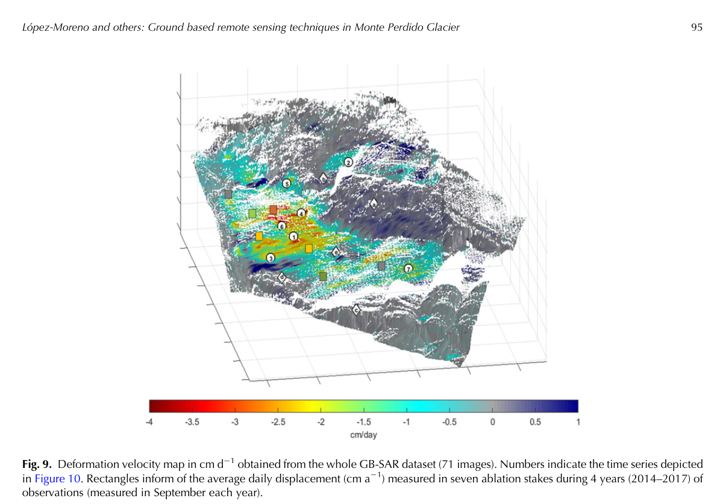

# Pyrenees velocities

[extret de l'article 'no hope for pyrenean glaciers' (juan ignacio lopez-moreno)](./articles/Pyrenean_glaciers_Lopez.pdf)

article sobre velocitats radar GB-SAR al mont perdut: 

[article]( ./articles/monte_perdido_Lopez_velocities_GB-SAR.pdf)

mix entre mateix autor i italians tenen un altre article del mont perdut,

- Radar images were acquired between July 15 2015 and 30 July 2015, covering a seven days lapse from 21h35m06s 2015.07. 22 to 18h52m04s 2015.07. 30, resulting in 160 acquired images.
- The accuracy of the deformation map for the Monte Perdido glacier was estimated through the residual cumulative displacement obtained in fixed points (rocks) to be less than ±3 mm/day.

[article](./articles/mt_perdido_velocities.pdf)

## Pyrenees Glaciars

- Aneto (RGI60-11.03208, 0.622 km²)  
- Ossoue (RGI60-11.03232, 0.449 km²)
- Monte Perdido (RGI60-11.03222 and RGI60-11.03221)  
- Maladeta (RGI60-11.03209 and RGI60-11.03210
- 